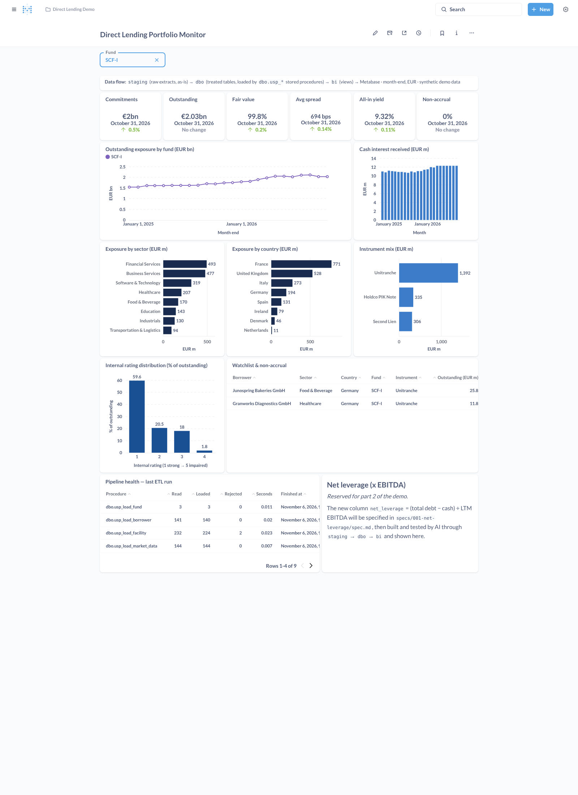

# Direct Lending Portfolio Demo

An end-to-end demo for a private-credit investment manager:

1. **Part 1, the pipeline and dashboard.** Synthetic loan-book data goes through a three-layer SQL warehouse in Postgres and onto a Metabase dashboard.
2. **Part 2, a new column built with AI.** A new metric (`net_leverage`) is added through every layer using only AI and **spec-driven development**: spec → plan → tasks → implementation → tests.



## Architecture

```
 data/raw/*.csv            LAYER 1: staging            LAYER 2: dbo                      LAYER 3: bi             Metabase
 (source extracts)  ──►  staging.*  (all TEXT,  ──►  dbo.usp_* stored procedures   ──►  bi.vw_* views   ──►  Direct Lending
  8 files, dirty         loaded as-is with          clean / type / dedupe / conform      (read-only for      Portfolio Monitor
                         \copy, + lineage cols)     reject  ──► dbo.* treated tables     bi_reader)          (dashboard-as-code)
                                                    log     ──► dbo.etl_run_log / etl_reject
```

| Layer | Schema | What lives there | Loaded by |
|---|---|---|---|
| 1. Staging | `staging` | `CREATE TABLE` for each source extract. All columns are `TEXT`, plus `_row_id`, `_source_file` and `_loaded_at`. | `sql/01_staging/10_load_staging.sql` (`\copy`) |
| 2. Treated | `dbo` | Typed tables with keys and constraints, reference tables, the monthly fact `dbo.facility_month`, and the audit tables | `CALL dbo.usp_run_etl();` (stored procedures) |
| 3. Presentation | `bi` | `bi.vw_*` views, the **only** objects Metabase can read | Views read `dbo` live |

It maps onto the medallion pattern as staging = bronze, dbo = silver and gold, and bi = the serving layer.
All ETL logic is SQL. Python is used only to generate the demo data and to call the Metabase API.

## Quick start

Requirements are Docker (with Compose) and Python 3.10+, standard library only.

```bash
make demo            # start Postgres and Metabase, run the pipeline and tests, build the dashboard
# open http://localhost:3000 and log in as admin@demo.local / Demo-Passw0rd!
```

The individual steps are `make up`, `make pipeline`, `make test`, `make dashboard`, `make psql` and `make reset`.
Running `make pipeline` deploys every SQL object from scratch, reloads staging, runs the ETL procedures and then runs the data-quality tests:

```
INFO:  dbo.usp_load_facility               read=232  loaded=224  rejected=2
...
    PASS  t09_bi_totals_reconcile
    All data-quality tests passed.
```

## Repository map

| Path | Purpose |
|---|---|
| `data/generator/generate_data.py` | Deterministic synthetic loan-book generator (seed 42) |
| `data/raw/` | The 8 source extracts (committed so the demo needs no Python) |
| `sql/00_reset.sql` | Drops the three schemas (full rebuild) |
| `sql/01_staging/` | Layer 1: staging DDL and the CSV load |
| `sql/02_dbo/` | Layer 2: tables, reference data, parse functions, `usp_*` procedures |
| `sql/03_bi/` | Layer 3: dashboard views and the read-only grants |
| `tests/sql/` | Data-quality tests. Each returns the number of failing rows; 0 means pass |
| `metabase/dashboard.json`, `metabase/cards/*.sql` | Dashboard as code: layout, filter, colours and one SQL file per card |
| `metabase/setup_metabase.py` | Builds or rebuilds the dashboard through the Metabase API (idempotent) |
| `specs/` | Spec-driven development: template, plus `001-net-leverage` for part 2 |
| `CLAUDE.md` | Rules the AI agent must follow when changing this repository |
| `docs/` | Architecture, data dictionary, demo runbook, branded mockup |

## Documentation

- [docs/ARCHITECTURE.md](docs/ARCHITECTURE.md): the pipeline in detail, cleaning rules per procedure, and lineage
- [docs/DATA_DICTIONARY.md](docs/DATA_DICTIONARY.md): every table, view and column
- [docs/DEMO_RUNBOOK.md](docs/DEMO_RUNBOOK.md): the demo script, timings and fallback plan
- [specs/README.md](specs/README.md): the spec-driven development workflow used in part 2
